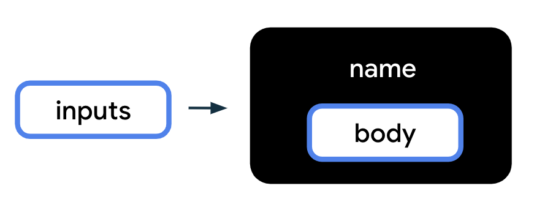

# Blog cá nhân & Ghi chú học tập

## Xuất bản lên GitHub Pages

Repository: [thaidotrum/blog-cot-dua](https://github.com/thaidotrum/blog-cot-dua).

Trong repository, vào **Settings → Pages**, chọn **Deploy from a branch**, nhánh **main**, thư mục **/(root)** rồi **Save**. File `.nojekyll` ở gốc giúp phục vụ trực tiếp HTML, JavaScript, JSON và Markdown.

Sau khi triển khai thành công, địa chỉ blog là `https://thaidotrum.github.io/blog-cot-dua/`. Mỗi lần đẩy thay đổi lên `main`, GitHub Pages triển khai lại website.

### Đăng bài mới

1. Viết file `.md` trong `content/posts/<chủ-đề>/`, thêm ảnh vào `assets/images/` nếu có.
2. Thêm metadata vào mảng `posts` trong `content/index.json`: `id` duy nhất, `title`, `date` dạng `YYYY-MM-DD`, `excerpt`, `cover`, `tags`, `path` trỏ tới file Markdown.
3. Nếu bài thuộc series, thêm `id` vào `postIds` của series theo thứ tự đọc. Bài độc lập không cần bước này.
4. Kiểm tra trên máy; commit và push lên `main` bằng GitHub Desktop hoặc Git. Home, Tags và Hành trình tự cập nhật từ danh mục.

Giữ bản nháp chưa muốn công khai ở ngoài repository. Blog chưa có màn hình quản trị để soạn và đăng bài.

Website chia sẻ kiến thức theo cách hiểu của tác giả, ghi chú học tập, trải nghiệm khi học và những bài viết cảm nghĩ. Mục tiêu là giúp người đọc dễ tìm nội dung, theo dõi một chuỗi bài và rút ra điều hữu ích từ trải nghiệm thực tế.

README này mô tả thiết kế và kế hoạch triển khai. Khung Phase 1 đã có hai bài mẫu, giao diện responsive và JavaScript cơ bản để đọc/chuyển bài. Các quyết định phát triển tuân theo [AGENTS.md](./AGENTS.md).

## Chạy thử khung Phase 1

Tại thư mục gốc dự án, chạy trình phục vụ file tĩnh (nếu đã có Python):

```sh
python -m http.server 8000
```

Mở `http://localhost:8000`. Không mở trực tiếp `index.html` bằng `file://` vì trình duyệt cần tải danh mục và Markdown qua `fetch`. Thư viện Marked và DOMPurify được tải từ CDN với phiên bản cố định, nên lần mở trang cần kết nối mạng.

Khung hiện có sidebar đánh số, trạng thái bài đang chọn, metadata, code block có màu cú pháp và nút copy, ghi chú `[!NOTE]`, Bài trước/tiếp theo và URL hash. Highlight.js qua CDN tô màu theo tên ngôn ngữ trong fenced code block (ví dụ `javascript`, `kotlin`); nếu thư viện không tải được thì vẫn hiển thị code thường. Tìm kiếm và LocalStorage/Export/Import sẽ triển khai ở các phase tiếp theo. Chưa triển khai bản thử lên GitHub Pages.

JavaScript Phase 1 nằm trong `assets/js/app.js`: tải danh mục lúc khởi động, dựng sidebar theo `postIds`, tải và làm sạch HTML từ Markdown, cập nhật header và điều hướng trong cùng series. URL trống hoặc `#/` mở trang home; `hashchange` hỗ trợ Back/Forward giữa danh sách và bài đọc. Sau khi chuyển trang/bài, trang cuộn lên đầu. Bài đầu/cuối ẩn nút không có đích; series một bài ẩn cả footer. URL không hợp lệ hoặc lỗi tải có thông báo và có thể chọn lại bài từ sidebar.

## About me dạng CV

Trang `#/about` có giới thiệu, kỹ năng, dự án, kinh nghiệm, học vấn và liên hệ. Mở bằng mục **About me** trên thanh điều hướng hoặc **Tìm hiểu về mình** ở home. Trang hỗ trợ URL trực tiếp, tải lại và Back/Forward; không cần backend.

Nội dung nằm trong `#resume-panel` của `index.html`. Thay tên/biệt danh, các phần trong dấu `[]`, URL `your-username` và email `you@example.com` bằng thông tin thật. Bỏ dòng thông báo `.resume-draft` sau khi đã hoàn thiện hồ sơ. Dự án blog hiện tại được dùng làm ví dụ thực tế; những thông tin cá nhân chưa có được ghi rõ là nội dung mẫu.

## Trang home và ảnh bìa

Phần đầu trang có khung **Một chút về mình** với lời giới thiệu ngắn và các liên kết GitHub, LinkedIn mở trong tab mới. Chỉnh nội dung trong `.about-card` ở `index.html`. Các URL đang dùng `your-username` làm ví dụ; thay bằng URL hồ sơ thật trước khi xuất bản. Có thể thêm liên kết khác bằng một thẻ `a.profile-link` trong `#profile-links`.

Trang home hiển thị toàn bộ bài theo `date` giảm dần (mới nhất trước). Mỗi thẻ có ảnh bìa, tiêu đề, series, ngày viết, tags và mô tả ngắn; nhấn vào thẻ mở URL `#/posts/<id>`. Nhấn **Trang chủ** hoặc tên blog để quay lại danh sách. Lưới tự chuyển từ ba cột sang hai/một cột khi màn hình nhỏ.

Trong mỗi bài ở `content/index.json`, bổ sung `cover` (đường dẫn ảnh tính từ gốc website) và `excerpt` (mô tả ngắn), ví dụ:

```json
{
  "cover": "assets/images/covers/javascript-start.svg",
  "excerpt": "Từ lời chào đầu tiên đến cách mình học JavaScript mỗi ngày."
}
```

Đây là các trường bổ sung cho metadata hiện có, không thay thế `id`, `title`, `date`, `tags`, `path`. Nếu thiếu hoặc lỗi ảnh bìa, giao diện dùng bìa dự phòng. Trang home đọc metadata từ danh mục nên không phải tải tất cả file Markdown.

## Chèn ảnh vào bài viết

Đặt ảnh trong `assets/images/` và chèn bằng Markdown tại vị trí muốn hiển thị:

```md

```

Đường dẫn này tính từ thư mục gốc website, không bắt đầu bằng `/` để dùng được trên GitHub Pages dưới đường dẫn repository. Ảnh đứng riêng một đoạn sẽ hiển thị trong khung có chú thích, giữ nguyên tỉ lệ và tự co theo chiều rộng vùng đọc. Bỏ phần trong dấu ngoặc kép nếu không cần chú thích. Nội dung mô tả trong `[]` giúp người dùng trình đọc màn hình hoặc khi ảnh không tải được.

Bài demo `#/posts/ham-trong-kotlin` trong series **Kotlin cơ bản** sử dụng sáu ảnh minh họa, xen kẽ đoạn giải thích, code và ghi chú kinh nghiệm.

## Kiến trúc dự kiến

- Website tĩnh, 100% client-side, triển khai miễn phí trên GitHub Pages.
- MVP dùng HTML, CSS hiện đại và JavaScript thuần, tách thành các module nhỏ theo chức năng.
- Không có backend, API riêng hoặc cơ sở dữ liệu phía server.
- Có thể dùng Tailwind CSS qua CDN. Chỉ chuyển sang React/Vite khi cần cấu trúc component và đã hỏi người dùng.
- Nội dung công khai nằm trong repository; LocalStorage dùng cho dữ liệu riêng trên trình duyệt.

## Giao diện Course/Docs kết hợp Blog

Tham chiếu ảnh demo người dùng cung cấp: nền xám nhạt, sidebar trái với các bài đánh số trong từng ô, bài đang chọn nổi bật và vùng đọc là một khung trắng có viền, bóng nhẹ. Giữ tinh thần giao diện tài liệu học tập, kết hợp thông tin và giọng viết của blog cá nhân.

### Bố cục tổng thể

```text
┌────────────────────────────────────────────────────────────┐
│ Tên blog / tên series                                      │
├─────────────────┬──────────────────────────────────────────┤
│ Tìm bài viết    │ Tiêu đề bài                              │
│                 │ Ngày viết · Tags · Thời gian đọc          │
│ Chủ đề / Series │                                          │
│ 1. Bài đầu tiên │ Nội dung Markdown                        │
│ 2. Bài đang đọc │ Code block có highlight                  │
│ 3. Bài tiếp theo│ Callout ghi chú / trải nghiệm thực tế    │
│                 │                                          │
│ Chủ đề khác     │ [Bài trước]                [Bài tiếp theo]│
└─────────────────┴──────────────────────────────────────────┘
```

### Sidebar bên trái

- Có ô tìm kiếm nhanh theo tiêu đề và tags; tìm không phân biệt chữ hoa/thường hoặc dấu tiếng Việt.
- Nhóm nội dung theo Chủ đề / Lộ trình (Topic/Series), mỗi nhóm có thể mở hoặc thu gọn.
- Các bài trong series được đánh số 1, 2, 3… theo thứ tự tác giả đặt.
- Bài đang chọn có màu nhấn, chữ đậm và trạng thái truy cập `aria-current`.
- Số thứ tự thể hiện thứ tự bài trong series, không tự biểu thị tiến độ đã học.
- Khi tìm kiếm, giữ tên nhóm và thứ tự gốc; hiển thị thông báo nếu không có kết quả.
- Bài cảm nghĩ độc lập có thể nằm trong nhóm riêng và đọc trực tiếp mà không cần theo lộ trình.

### Main panel bên phải

- **Header bài viết:** tiêu đề, ngày viết, tags chủ đề và thời gian đọc ước tính.
- **Nội dung:** đoạn văn, tiêu đề phụ, danh sách, liên kết, hình ảnh, code block có highlight theo ngôn ngữ và callout cho ghi chú hoặc kinh nghiệm thực tế.
- **Footer:** nút “Bài trước” và “Bài tiếp theo”, kèm tên bài đích khi phù hợp. Điều hướng theo thứ tự trong cùng series, độc lập với kết quả tìm kiếm. Ở đầu/cuối series, ẩn nút không có bài đích; bài độc lập không cần cặp nút này.
- Giới hạn chiều rộng vùng đọc để dòng chữ không quá dài; dùng khoảng cách và độ tương phản rõ ràng.

### Trên điện thoại

- Chuyển thành một cột; sidebar mở qua nút “Danh sách bài” và đóng sau khi chọn bài.
- Nội dung và điều hướng vừa màn hình; code block có thể cuộn ngang riêng.
- Có trạng thái đang tải, không tìm thấy bài và lỗi tải nội dung, kèm cách thử lại hoặc chọn bài khác.

## Lưu trữ nội dung

### Phương án đề xuất: Markdown + danh mục JSON

Mỗi bài viết là một file `.md`. File `content/index.json` lưu metadata, danh sách series và đường dẫn tương đối tới bài. Cách này giúp tác giả viết nội dung thuận tiện, còn giao diện có thể tải danh mục để dựng sidebar và tìm kiếm nhanh.

```text
Blog/
├── AGENTS.md
├── README.md
├── index.html                 # Khung giao diện
├── assets/
│   ├── css/styles.css         # Bố cục, typography, responsive
│   ├── js/
│   │   ├── app.js             # Khởi tạo và phối hợp các module
│   │   ├── content.js         # Đọc danh mục và nội dung bài
│   │   ├── router.js          # Đọc/cập nhật đường dẫn bài
│   │   ├── sidebar.js         # Series, bài đang chọn, tìm kiếm
│   │   ├── article.js         # Render nội dung và điều hướng
│   │   └── storage.js         # LocalStorage, Export/Import JSON
│   └── images/               # Hình ảnh dùng trong bài
└── content/
    ├── index.json            # Metadata và thứ tự các bài
    └── posts/
        ├── javascript/
        │   ├── bat-dau.md
        │   └── bien-va-kieu-du-lieu.md
        └── cam-nghi/
            └── hoc-cham-ma-chac.md
```

Đây là cấu trúc dự kiến; chỉ tạo module khi phase tương ứng cần đến.

Ví dụ danh mục:

```json
{
  "schemaVersion": 1,
  "series": [
    {
      "id": "javascript-co-ban",
      "title": "JavaScript cơ bản",
      "postIds": ["bat-dau", "bien-va-kieu-du-lieu"]
    }
  ],
  "posts": [
    {
      "id": "bat-dau",
      "title": "Mình bắt đầu học JavaScript như thế nào",
      "date": "2026-10-10",
      "tags": ["JavaScript", "Trải nghiệm học tập"],
      "path": "content/posts/javascript/bat-dau.md"
    },
    {
      "id": "bien-va-kieu-du-lieu",
      "title": "Ghi chú về biến và kiểu dữ liệu",
      "date": "2026-10-11",
      "tags": ["JavaScript", "Ghi chú"],
      "path": "content/posts/javascript/bien-va-kieu-du-lieu.md"
    }
  ]
}
```

- ID bài phải duy nhất và ổn định để liên kết đã chia sẻ tiếp tục hoạt động.
- `postIds` xác định thứ tự bài trong series; bài không thuộc series xuất hiện trong nhóm bài độc lập.
- Thời gian đọc được ước tính từ nội dung đã tải theo một tốc độ đọc thống nhất và hiển thị tối thiểu 1 phút.
- Markdown dùng fenced code block kèm tên ngôn ngữ. Chọn một thư viện Markdown và một thư viện highlight gọn nhẹ, cố định phiên bản khi triển khai.
- Quy ước callout dự kiến là blockquote mở đầu bằng `[!NOTE]` hoặc `[!TIP]`; renderer chuyển thành hộp ghi chú/kinh nghiệm có nhãn rõ ràng.
- Làm sạch HTML sau khi chuyển Markdown để nội dung không thực thi script. Hình ảnh và liên kết nội bộ được xử lý theo đường dẫn nền của website.

### Phương án thay thế: nội dung trong JSON

Có thể lưu nội dung bài trong trường `body` của các phần tử thuộc mảng `posts`. Cách này phù hợp khi có ít bài ngắn; file Markdown riêng thuận tiện hơn khi viết bài dài và có nhiều code. MVP chọn một phương án nhất quán, ưu tiên Markdown + danh mục JSON; không cần triển khai cả hai bộ lưu trữ.

### Luồng đọc và xuất bản

1. Trình duyệt tải `content/index.json`, dựng sidebar và chọn bài theo URL.
2. Khi chọn bài, tải file Markdown tương ứng, render nội dung, metadata và nút điều hướng.
3. Dùng URL dạng `#/posts/bat-dau` để chia sẻ bài và tải lại trực tiếp trên GitHub Pages; hỗ trợ Back/Forward của trình duyệt.
4. Tác giả viết/sửa file nội dung, cập nhật danh mục, kiểm tra rồi đưa thay đổi lên repository và triển khai GitHub Pages. Người đọc nhận nội dung công khai từ bản triển khai đó.

Dùng đường dẫn tài nguyên tương đối hoặc xử lý base URL thống nhất để hoạt động cả tại domain gốc và dưới đường dẫn repository. Khi phát triển, dùng trình phục vụ file tĩnh để kiểm tra `fetch`; công cụ này chỉ phục vụ phát triển, không phải backend của ứng dụng.

### Khám phá bằng tags

- Mục **Tags** trên thanh điều hướng mở `#/tags`, hiển thị các tag và số bài tương ứng; tag có nhiều bài được nhấn mạnh nhẹ.
- Bấm tag để mở `#/tags/<tag được mã hóa URL>` và xem các bài cùng tag, mới nhất trước. Tag trong thẻ bài và header bài viết cũng dẫn tới danh sách này.
- Danh sách được tạo tự động từ trường `tags` của mỗi bài trong `content/index.json`. Dùng tên nhất quán như `JavaScript`, `Kotlin`, `Ghi chú`, `Trải nghiệm học tập`, `Hình minh họa`; không cần tạo file dữ liệu tags riêng.
- URL hỗ trợ tải lại và Back/Forward; tag chưa có bài hiển thị thông báo rỗng cùng liên kết quay lại tất cả tags.

### Gom bài theo khóa học, sách và chủ đề

- Mục **Series** mở `#/series`, hiển thị từng nhóm với tên, loại, mô tả và số bài. Chọn nhóm để mở `#/series/<id>` và xem danh sách bài đánh số theo thứ tự đọc.
- Nút **Đọc từ bài đầu** mở bài đầu tiên. Thanh **X · tên series** phía trên trang đọc giúp thoát về trang tổng hợp Series. Các URL hoạt động khi tải lại và dùng Back/Forward trên GitHub Pages.
- Khi đọc bài, sidebar chỉ hiển thị các bài thuộc cùng series. Bài độc lập không hiển thị danh sách của các series khác.
- Header tên blog và menu chính ẩn khi đọc bài, hiện lại ở Home, Series, Tags và About me. Trên điện thoại, nút **Danh sách bài** nằm cạnh thanh thoát series.
- Khi cuộn đọc bài, thanh series và sidebar giữ vị trí trên màn hình. Sidebar có vùng cuộn riêng nếu danh sách dài; chiều cao thanh series được đo tự động để không che các bài khi tên series xuống dòng.
- Dùng phím **← / →** hoặc nút **Bài trước / Bài tiếp theo** để chuyển bài trong series với hiệu ứng trượt theo hướng đọc. Bài mới tải xong mới thay bài cũ; mỗi bài mở ở đầu trang. Phím không chiếm thao tác nhập liệu hoặc cuộn ngang code; hiệu ứng tắt khi thiết bị chọn giảm chuyển động.
- Các nhóm được khai báo trong mảng `series` của `content/index.json`. `type` nhận `course` (khóa học), `book` (sách) hoặc `topic` (chủ đề); bỏ trống mặc định là chủ đề. `description` giới thiệu ngắn điều bạn học hoặc muốn chia sẻ trong nhóm.
- `postIds` chứa ID các bài đã khai báo trong mảng `posts`, theo thứ tự bạn muốn người đọc đi qua, không sắp xếp theo ngày. Nhóm chưa có bài vẫn hiển thị với số bài bằng 0.
- Hai nhóm mẫu hiện tại là chủ đề JavaScript và Kotlin. Khi viết về khóa học hoặc sách thật, thêm nhóm tương tự ví dụ dưới đây và đưa ID bài liên quan vào `postIds`.

```json
{
  "id": "ghi-chu-doc-sach",
  "title": "Tên cuốn sách bạn đang đọc",
  "type": "book",
  "description": "Những điều mình học được, trải nghiệm áp dụng và cảm nghĩ khi đọc cuốn sách này.",
  "postIds": []
}
```

### Hành trình viết bài (Archives)

- Mục **Hành trình** mở `#/archives`, trình bày timeline theo năm và tháng, bài mới nhất trước. Mỗi bài có ngày đăng, tiêu đề, mô tả và liên kết mở trang đọc; mỗi tháng có số bài tương ứng.
- Timeline tự tạo từ `date` trong `content/index.json`, dùng định dạng `YYYY-MM-DD`; không cần nhập dữ liệu riêng. Trang thể hiện lịch sử bài đã đăng, không theo dõi bản nháp hoặc thời gian soạn bài.
- URL hỗ trợ tải lại và Back/Forward, có trạng thái rỗng khi chưa có bài viết.

### LocalStorage và sao lưu JSON

- Chỉ lưu tùy chọn đọc như giao diện sáng/tối, trạng thái mở nhóm hoặc bản nháp nếu sau này có tính năng soạn thảo.
- Export/Import JSON sao lưu dữ liệu cục bộ, có phiên bản định dạng và kiểm tra dữ liệu trước khi ghi.
- Yêu cầu xác nhận nếu Import ghi đè dữ liệu hiện có; file lỗi không làm mất dữ liệu đang lưu.
- Xử lý trường hợp LocalStorage bị chặn hoặc hết dung lượng, thông báo bằng tiếng Việt và giữ khả năng đọc bài công khai.
- Import bản nháp không xuất bản bài cho người khác; xuất bản vẫn theo quy trình nội dung tĩnh trong repository.

## Kế hoạch triển khai

| Phase | Công việc | Điều kiện hoàn thành |
| --- | --- | --- |
| 1 — MVP đọc bài | Tạo HTML/CSS/JS nền; bố cục hai cột theo ảnh demo; danh mục với một series và vài bài mẫu; sidebar đánh số, chọn bài; header metadata; render Markdown; URL hash; Bài trước/tiếp theo; bố cục điện thoại cơ bản. | Đọc được bài từ file thật, chọn bài và tải lại URL vẫn đúng; điều hướng trong series đúng; triển khai thử trên GitHub Pages đọc được nội dung. |
| 2 — Tìm kiếm và trình bày | Tìm nhanh tiêu đề/tags; thu gọn series; nhóm bài độc lập; code highlight; callout; thời gian đọc; trạng thái tải/lỗi/rỗng; tinh chỉnh typography và sidebar trên điện thoại. | Tìm tiếng Việt có/không dấu hoạt động; bài đang chọn rõ ràng; code và callout dễ đọc; xử lý được bài thiếu hoặc lỗi tải. |
| 3 — Tùy chọn đọc và sao lưu | Giao diện sáng/tối; lưu tùy chọn bằng LocalStorage; Export/Import JSON có kiểm tra phiên bản, dữ liệu và xác nhận ghi đè. | Tùy chọn giữ sau tải lại; Export rồi Import khôi phục được dữ liệu; JSON lỗi không ghi đè; đọc bài vẫn hoạt động khi LocalStorage không khả dụng. |
| 4 — Hoàn thiện và phát hành | Rà soát giao diện, bàn phím, focus, tương phản; tối ưu tải nội dung và hình ảnh; cập nhật title/description theo bài; hướng dẫn thêm bài; kiểm tra đường dẫn và bản triển khai GitHub Pages. | Hoạt động trên máy tính và điện thoại; liên kết trực tiếp, Back/Forward, ảnh và tài nguyên đúng dưới đường dẫn repository; tài liệu xuất bản rõ ràng. |

Metadata cập nhật bằng JavaScript phục vụ trải nghiệm trong trình duyệt; khả năng xem trước liên kết của mạng xã hội có thể hạn chế với website client-side. Nếu cần metadata riêng cho từng bài ngay trong HTML, thảo luận trước khi bổ sung bước tạo trang tĩnh.

## Nguyên tắc thực hiện

- Mỗi lần làm một tính năng nhỏ, kiểm tra xong rồi chuyển sang tính năng tiếp theo.
- Code gọn, tên biến/hàm rõ nghĩa; comment tiếng Việt cho logic cần giải thích.
- Kiểm tra phù hợp với thay đổi: đọc bài, điều hướng, tìm kiếm, màn hình nhỏ hoặc vòng Export/Import.
- Hỏi trước khi đổi cấu trúc lớn, công nghệ chính, kiến trúc hoặc mô hình lưu trữ.
- Chức năng quản lý tiến độ học, đăng nhập, bình luận và trình soạn thảo không thuộc MVP; chỉ lên kế hoạch thêm khi có yêu cầu.
